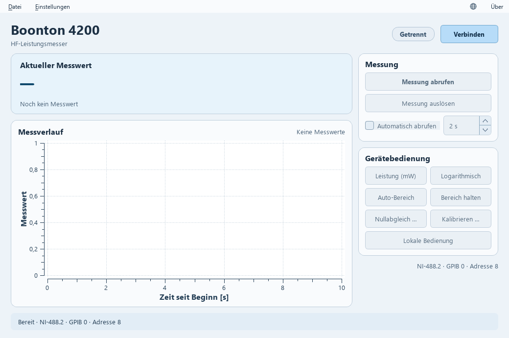
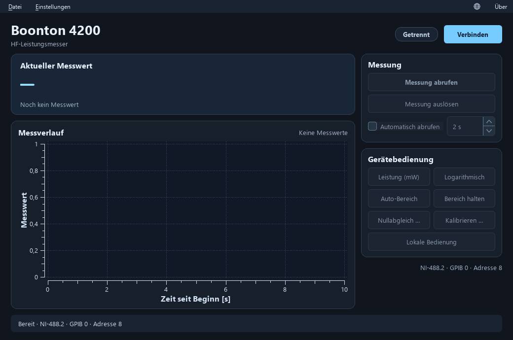

# Boonton 4200 Control

Eigenständige Windows-Anwendung für den Boonton 4200 HF-Leistungsmesser. Die Bedienoberfläche verwendet Qt Widgets, der Messverlauf Qwt 6.3 und die IEEE-488-Kommunikation den installierten NI-488.2-Treiber mit Unterstützung für die Programmarchitektur.

## Bildschirmaufnahmen

| Hell | Dunkel |
| --- | --- |
| <a href="docs/screenshots/boonton4200-hell.png"></a> | <a href="docs/screenshots/boonton4200-dunkel.png"></a> |

## Installation unter Windows

Die Setups für x86 und x64 mit Qt-, Qwt- und MinGW-Laufzeitdateien stehen im [GitHub-Release](https://github.com/GitterRalf/boonton4200-control/releases/latest) bereit. Für den Download ist ein GitHub-Konto mit Zugriff auf das private Repository erforderlich. Standardordner ist `C:\Programme\Boonton 4200 Control`. Den NI-488.2-Treiber mit Unterstützung für die Programmarchitektur separat installieren.

## Bedienung

- **Verbinden** liest die aktuelle Geräteanzeige. Voreingestellt sind **Bus 0**, **Adresse 8** und **CR + LF** als Nachrichtenende. Unter **Einstellungen → Verbindung** lassen sich Bus, Adresse und Terminator ändern. Der Terminator muss zu den Schaltern 6 und 7 am Gerät passen.
- **Messung abrufen** liest die Geräteanzeige. **Messung auslösen** sendet zusätzlich den Trigger `T` und liest danach. **Automatisch abrufen** wiederholt das Lesen im eingestellten Abstand. Die Einheit und der Kanal stammen aus der Antwort des Geräts. Bei einem Messfehler zeigt das Programm den Gerätestatus an und lässt den Wert im Messverlauf aus.
- **Leistung (mW)** und **Logarithmisch** wählen die Gerätemodi `P` und `B`. Die logarithmische Ausgabe ist dBm oder dBr, je nach eingestelltem Referenzwert. **Auto-Bereich** und **Bereich halten** verwenden `A` und `O`. Bei vorhandenem zweiten Kanal unter **Einstellungen → Verbindung** die Option **4200-03** aktivieren. Dann stehen Kanal 1, Kanal 2 und die Differenz zur Auswahl.
- **Nullabgleich** (`Z`) und **Kalibrieren** (`K`) werden ausdrücklich bestätigt. Vorbereitung von Sensor, HF-Eingang und Leistungsreferenz siehe Abschnitte 3-21 und 3-23 im Handbuch. **Lokale Bedienung** gibt das Gerät über GPIB an die Frontplatte zurück.
- Der Verlauf hält die letzten 1000 gültigen Werte derselben Einheit und desselben Kanals. Bei einem Wechsel beginnt eine neue Reihe. **Datei → Messwerte als CSV speichern** exportiert die angezeigte Reihe mit Zeitstempel, Kanal, Einheit und Bereichscode. Der vorgeschlagene Dateiname enthält Datum und Uhrzeit.
- Das Globus-Symbol oben rechts wechselt zwischen **Deutsch**, **English** und **Français**. Die Sprache wird beim Wechsel direkt gespeichert.
- **Einstellungen → Darstellung** wechselt zwischen **Hell** und **Dunkel**. **Einstellungen speichern** (`Strg+S`) übernimmt die Verbindung, Darstellung und das Abrufintervall für den nächsten Start. Die letzte Fensterposition und -größe werden wiederhergestellt. **Über** zeigt das animierte OsciViewer-Logo, die Version und Ralf Tralow. Der Qt-Community-Build enthält auch **Über Qt**. **Über → Nach Updates suchen** startet den Versionsvergleich manuell. Für das private Repository wird eine mit einem berechtigten Konto angemeldete GitHub CLI benötigt (`gh auth login`).

Das Protokoll folgt Anhang A und B des Boonton-4200-Handbuchs, insbesondere den Tabellen A-2 und B-2 sowie den Abschnitten A-22 und B-22. Das Gerät muss eine native IEEE-488-Schnittstelle (4200-01A oder 4200-01B) besitzen. [Herstellerhandbuch als PDF](https://www.testunlimited.com/pdf/Boonton%204200_Manual.pdf).

## Bauen und starten

Die Version steht in [version.h](version.h). In Qt Creator lässt sich die CMakeLists.txt direkt öffnen. Benötigt werden ein 64-Bit-Windows-Kit mit Qt Widgets, Qt Network, LinguistTools und [Qwt 6.3](https://qwt.sourceforge.io/qwtinstall.html) für dasselbe Kit. Die lokale Qwt-Installation liegt unter `.deps/qwt` für x64 und `.deps/qwt-qt5-x86` für x86. Ein anderer Pfad lässt sich mit `-DQWT_ROOT=…` einstellen. Für einen Build ohne **About Qt** `-DBOONTON_QT_COMMUNITY=OFF` setzen.

Mit dem auf diesem Rechner installierten Qt-MinGW-Kit im Projektordner aufrufen:

```powershell
.\build.ps1                    # x64
.\build.ps1 -Architecture x86  # x86
```

Das Skript benötigt CMake 3.24 oder neuer und Ninja. Beim Pfad **Messgeräte** verwendet es während des Builds einen vorübergehenden Laufwerksalias, weil die installierten MinGW- und Qt-Werkzeuge dort mit dem Umlaut scheitern. Quellen und Build-Ausgabe liegen im normalen Projektordner. Abweichende Installationspfade lassen sich über `-QtKit` und `-CompilerBin` angeben.

Danach `build\Boonton4200-Control.exe` starten. Für das Windows-Setup anschließend `Boonton4200-Control.iss` mit Inno Setup kompilieren. Es übernimmt Programmversion und Icon aus dem Projekt und legt die Setupdatei unter `installer` ab.


### Windows-Architekturen

Die x86-Ausgabe verwendet Qt 5.15.19 mit MinGW 8.1 und hat einen eigenen
Installationsordner **Boonton 4200 Control (32 Bit)**. Auf 64-Bit-Windows können beide
Ausgaben parallel installiert werden. Die x64-Ausgabe verwendet weiterhin
Qt 6 und ist beim Build der Standard.

Der Build für x86 nutzt `build-x86`, der Build für x64 den Ordner `build`.
Die Installer entstehen im Projektordner mit folgenden Aufrufen.

```powershell
ISCC.exe Boonton4200-Control.iss
ISCC.exe /DBuildArch=x86 Boonton4200-Control.iss
```

## Lizenz

Quellcode und animiertes OsciViewer-Logo stehen unter der [MIT-Lizenz](LICENSE). Die Hinweise zu Qt, Qwt und MinGW stehen in [THIRD-PARTY-NOTICES.txt](THIRD-PARTY-NOTICES.txt).
